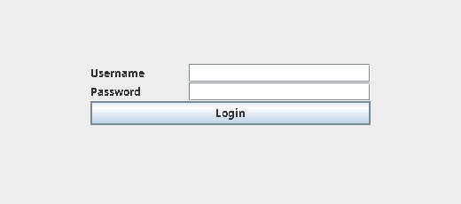
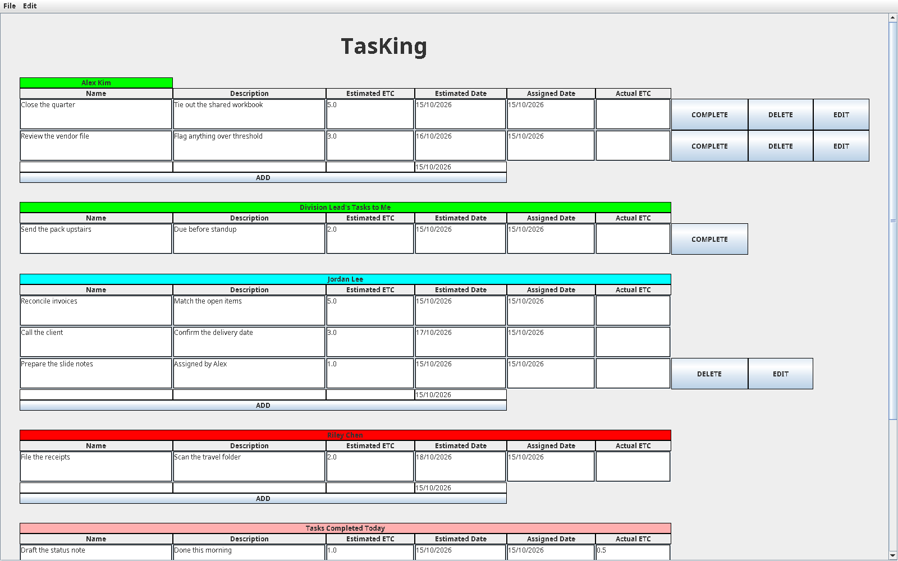

# TasKing

TasKing is a desktop task board for a small team. People log in, write down the work they expect to finish, and close it with the hours it actually took. A manager can hand work to someone on their team, drop work into a shared pool, and export completed tasks to a spreadsheet.

## Original context

Pranav Prem wrote this in 2016 as a Java Swing application. It was meant to run as one JAR from a shared drive, with no database server. The "database" is a folder of JSON files, so the whole team could point at the same directory. User ids were expected to be 8 digits, matching the PeopleSoft ids used at the time.

The last functional commit called the build the first working version and left a note to fix backup. Backup always wrote to `D:\`, so it only worked on that one Windows machine. A later commit also mentioned the on-screen layout still needed scaling work. The board is still that original GridBag layout.

## How it works

Opening the JAR with no arguments shows the login window. `New` creates a user from prompts in the terminal. `Flush` empties every task file and leaves the user list and the task-number counter alone.

After login the board is one long page:

- **Your tasks.** Add a row, edit the description, or mark it complete with the actual hours. Your name is green when today's open estimates, plus manager-assigned estimates, plus actual hours on tasks whose estimated date is today, add up to at least 8. Otherwise it is red.
- **Your manager's tasks to you.** You can complete these. If you pulled the task from their pool, you can release it back.
- **Each person who reports to you.** You see their own tasks, the tasks you assigned them, and what they finished today. You can add, edit, or delete the tasks you assigned.
- **Your pool**, if anyone reports to you. Tasks here are visible to that group. They pull a task onto their own list (the name gains a `--POOLTASK` suffix) or you can delete it.
- **Your manager's pool.** You can pull a task from it.
- **Tasks completed today.**

File → **Get Data** writes a CSV of completed tasks for you and everyone below you in the reporting line. Edit → **Backup** copies the data folder to a dated folder beside it. Edit → **Change Password** updates the user file. Edit → **Refresh** reloads the board from disk.

Hours are called ETC (estimated time to complete) and actual ETC. Dates are `dd/MM/yyyy`.

## Run it today

You need Java 21 or newer. Maven is included via the wrapper.

```bash
./mvnw -B package
java -jar target/Tasking-0.0.1-SNAPSHOT.jar
```

The first launch has no users. Create one in another terminal, from the same directory:

```bash
java -jar target/Tasking-0.0.1-SNAPSHOT.jar New
```

The prompts ask for an id, a password, a name, and a manager id. Names can contain spaces. The original convention is an 8-digit id; the app no longer crashes when an id is a different length, but ids cannot contain spaces or a path.

A top-level person still needs a manager id. Use something like `00000000` if they have no manager in the file.

Task files are created in `data/` next to where you started the JVM. To keep using a chosen folder, either:

- put that path on the first line of `location.txt` in the working directory (see `location.txt.example`), or
- set `TASKING_DATA_DIR` to the folder.

`tasking.dataDir` as a Java system property wins over the environment variable, which wins over `location.txt`.

```bash
java -jar target/Tasking-0.0.1-SNAPSHOT.jar Flush
```

Backup writes `TasKing Backup <dd-MMM-yyyy>` next to the data folder. Set `TASKING_BACKUP_DIR` (or `tasking.backupDir`) to put that dated folder somewhere else. The backup folder must not sit inside the data folder.

Tests:

```bash
./mvnw verify
```

## Tech stack

- Java 21 (class files target 21; newer JDKs are fine)
- Maven, with a shaded JAR so Jackson is included
- Swing for the windows
- Jackson 2.22.3 for the JSON files
- JUnit Jupiter 5.14.4
- Spotless with google-java-format, enforced in `./mvnw verify`
- GitHub Actions on Java 21

## Project structure

```
src/main/java
  beans/        task and user records, plus the Swing rows that edit them
  controller/   main: GUI, New, or Flush
  dao/          read and write the JSON files and the CSV export
  events/       button and menu listeners
  gui/          login window and the board
  services/     login, tasks, pools, backup, new users
  util/         data-folder location, dates, the task-number counter
src/test/java   unit tests, plus ScreenshotHarness for the pictures below
```

There is one flat data folder, not a server. The files are:

| File | Contents |
| --- | --- |
| `User.json` | Every person, including passwords in plain text |
| `tasknum.txt` | Last assigned task number |
| `{id}.json` | That person's open tasks |
| `{manager}-{id}.json` | Tasks the manager assigned to that person |
| `{id}-completed.json` | Tasks that person has finished |
| `{manager}-pool.json` | The manager's shared pool |

## Screenshots

Sample people in these pictures are not real accounts. The board is the 1600×1000 window the app opens.





## Caveats

- Passwords are stored in plain text in `User.json`. Do not commit that file. `data/` is gitignored.
- Two people saving at the same moment can overwrite a JSON file or take the same task number. The original design assumed a shared folder and no locking.
- The CSV replaces commas in text with periods instead of quoting fields.
- Completed-task dates are stored as Jackson's default epoch milliseconds.
- Badge pictures (`timesaver.png` and `crown.png` in the working directory) were never part of the repo. The call that would show them is still commented out.
- The board layout is the original one. Wide rows and the fixed window size are unchanged on purpose.
